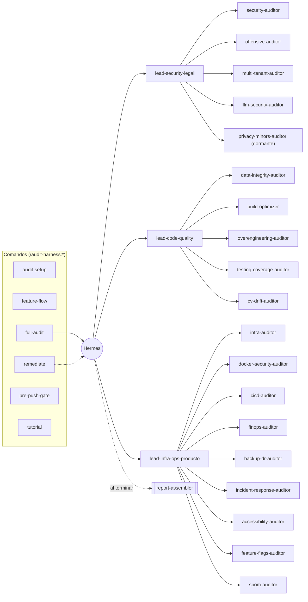

# audit-harness

Al instalarlo, el plugin avisa solo en la primera sesión de cada proyecto
nuevo: **"Escribí `/audit-harness:tutorial` para ver todos los flujos."**
Si no esperás a que te lo diga, corré `/audit-harness:tutorial` apenas
instales.

## Mapa completo

Hermes despacha a 3 leads temáticos, cada uno fan-out a sus auditores. Las
6 skills (del lado izquierdo) son los comandos que vos tipeás; todo lo que
cuelga de Hermes corre solo, invocado por esas skills.



19 auditores en total (6 núcleo, siempre corren: `security`,
`data-integrity`, `build-optimizer`, `overengineering`, `infra`,
`testing-coverage` + 13 verticales de producto/legal/ops, 12 activas por
default y `privacy-minors` dormante hasta que el proyecto confirme que
aplica).

## Mapa: fases × alcance

```
Fases:    audit-setup → feature-flow → full-audit → remediate → pre-push-gate
Alcance:  completo | por lead (3) | por vertical/auditor (19)
```

| Fase | Cuándo | Comando | Qué hace |
|---|---|---|---|
| Setup | una vez por proyecto | `/audit-harness:audit-setup` | Wizard de conexión + bootstrap: detecta qué ya está conectado, genera `audit.config.yaml` y aprende la memoria propia del proyecto (`CLAUDE.md`, `.claude/rules/*.md`, vault propio si existe) en `product-model.md`. |
| Pre-feature | antes de arrancar algo nuevo | `/audit-harness:feature-flow` | Encadena las skills de buenas prácticas del proyecto (grill-with-docs → to-prd → to-issues → triage → tdd) con gates de confirmación entre paso y paso. |
| Auditar | cuando quieras, las veces que quieras | `/audit-harness:full-audit [alcance]` | Despacha a Hermes → leads → auditores (alcance completo o acotado); termina en un Artifact con los hallazgos rankeados, armado por `report-assembler`. |
| Corregir | para implementar los fixes de verdad | `/audit-harness:remediate` | Triage por riesgo, GitFlow issue→develop→main, paralelización con worktrees aislados, re-auditoría dirigida al final, cierre del loop de memoria (vault portable + vault propio del proyecto). |
| Pre-push | a mano, antes de cada `git push` | `/audit-harness:pre-push-gate` | Revisión de 3 capas del diff (seguridad, estructural, patrones del proyecto) antes de pushear. Invocación manual a propósito, no hay hook de git. |
| Ayuda | para ver todo esto de nuevo | `/audit-harness:tutorial` | Lista las 5 fases, cómo acotar alcance, y dónde vive el vault. |

`full-audit` corre todo por default. Para acotarlo:

```
/audit-harness:full-audit                  # todo lo habilitado
/audit-harness:full-audit security         # un vertical/auditor puntual
/audit-harness:full-audit security-legal   # un lead completo
```

o en prosa libre ("auditá solo RLS") hablándole a Hermes directamente.

### Qué audita cada uno de los 19 auditores

| Lead | Auditor | Qué mira |
|---|---|---|
| security-legal | `security-auditor` | SAST, secret scanning, CVEs en dependencias, patrones OWASP |
| security-legal | `offensive-auditor` | Pentest activo (solo local/staging): bypass de auth, fuzzing, romper RLS |
| security-legal | `multi-tenant-auditor` | Que un usuario/organización no vea datos de otro (RLS o filtro de tenant) |
| security-legal | `llm-security-auditor` | Prompt injection, costo sin límite, fuga de datos entre tenants vía output de un LLM |
| security-legal | `privacy-minors-auditor` *(dormante)* | Datos biométricos/identidad de menores y consentimiento válido |
| code-quality | `data-integrity-auditor` | Paginación inestable, insert vs. upsert, id crudo vs. identidad resuelta, excepciones tragadas |
| code-quality | `build-optimizer` | Bundle, tree-shaking, tiempos de build, dependencias sin usar |
| code-quality | `overengineering-auditor` | El único que mide "sacar": código muerto, generalización especulativa, abstracción prematura, módulos shallow, reinventar la rueda |
| code-quality | `testing-coverage-auditor` | Cobertura real sobre lógica crítica (parsers, cálculos, políticas de seguridad) |
| code-quality | `cv-drift-auditor` | Drift de modelos de Computer Vision/ML propios en producción |
| infra-ops-producto | `infra-auditor` | Config de deploy/gateway, CORS, secrets expuestos, rate limiting, observabilidad |
| infra-ops-producto | `docker-security-auditor` | Imagen base, usuario de ejecución, multi-stage |
| infra-ops-producto | `cicd-auditor` | Fallos intermitentes, permisos excesivos en workflows, secretos en CI |
| infra-ops-producto | `finops-auditor` | Gasto variable de cloud/inferencia sin tope |
| infra-ops-producto | `backup-dr-auditor` | Si existe backup real y si alguna vez se probó un restore |
| infra-ops-producto | `incident-response-auditor` | Runbook mínimo para cuando algo se rompe en producción |
| infra-ops-producto | `accessibility-auditor` | WCAG, prioridad según si hay superficie pública |
| infra-ops-producto | `feature-flags-auditor` | Rollout controlado para features riesgosas |
| infra-ops-producto | `sbom-auditor` | Compliance de licencias open source (copyleft en producto que se vende) |

Detalle completo de la jerarquía, el inventario de componentes, y las
decisiones tomadas durante la construcción en
`plugins/audit-harness/README.md` y en `/audit-harness:tutorial`.

## Uso rápido

**1. Instalar** (una vez por máquina — funciona en cualquier computadora,
no hace falta clonar el repo a mano):

```bash
claude plugin marketplace add TomasAbrigo/audit-harness
claude plugin install audit-harness@audit-harness-marketplace
```

Queda disponible en *cualquier* proyecto de esa máquina, sin pasos extra. Si
estás desarrollando el harness mismo (no solo usándolo) y preferís apuntar a
una copia local en vez del repo de GitHub:

```bash
claude plugin marketplace add /ruta/a/audit-harness
claude plugin install audit-harness@audit-harness-marketplace
```

o, sin instalar nada, para probar cambios sueltos en una sola sesión:

```bash
claude --plugin-dir /ruta/a/audit-harness/plugins/audit-harness
```

**2. Conectar el proyecto** (una vez por repo, dentro de una sesión de Claude
Code, parado en la raíz del repo que querés auditar):

```
/audit-harness:audit-setup
```

Este paso también aprende la memoria propia del proyecto (`CLAUDE.md`,
`.claude/rules/*.md`, un vault de aprendizajes si ya tiene uno) para que el
resto de los auditores no corra genérico sobre este repo puntual.

**3. Auditar** (cuando quieras, las veces que quieras):

```
/audit-harness:full-audit
```

Te devuelve un Artifact con todos los hallazgos, rankeados por severidad.

**4. Corregir de verdad** (opcional, cuando quieras implementar los fixes en
vez de solo leer el reporte):

```
/audit-harness:remediate
```

Triage por riesgo, GitFlow issue→develop→main, re-auditoría dirigida al final
antes de tocar `main`, y el cierre del loop de memoria (vault portable del
harness + vault propio del proyecto si declara uno).

**Otros comandos del día a día:**

```
/audit-harness:feature-flow      # antes de arrancar una feature nueva
/audit-harness:pre-push-gate     # a mano, antes de cada git push
/audit-harness:tutorial          # todos los flujos, de nuevo, cuando se te olviden
```

Eso es todo lo que hace falta saber para usarlo. El resto de este documento
es cómo está armado por dentro.

---

## Qué es

Hermes orquesta una jerarquía de auditores — seguridad, pentest, integridad
de datos, arquitectura, build, infra, y 13 verticales de producto/legal/ops —
sobre cualquier proyecto. Fact store propio (SQLite+FTS5) para no repetir
hallazgos entre corridas, y un vault de conocimiento (playbooks +
best-practices) que viaja de proyecto en proyecto.

Diseño completo (arquitectura, decisiones y roadmap) en el Artifact de mapa
del harness — no se repite acá, ese documento es la fuente de verdad del
diseño original.

## Estado

Fase 1 a 7 del roadmap original, completas. Fases 1-4: Hermes + jerarquía de
2 niveles (3 leads) + 5 auditores núcleo + 13 verticales (12 activas +
`privacy-minors` dormante) + report-assembler + fact store + 5 skills (el
quinto, `remediate`, agregado después de validar el flujo completo de
descubrimiento→fix→merge en una corrida real de punta a punta sobre un
proyecto real). Fase 5 (memoria real + invocación clara): el vault portable
(`best-practice.md`/`playbook.md`) ahora se escribe de verdad (antes quedaba
vacío para siempre); `product-model.md` ahora lo lee cada auditor de dominio
como fuente primaria antes de sus checks genéricos; `full-audit` acepta
alcance acotado por argumento; y un hook de `SessionStart` + el nuevo skill
`tutorial` hacen que todos los flujos sean descubribles desde el primer uso.
Fase 6: sexto auditor núcleo, `overengineering-auditor` — el único que mide
en la dirección de "sacar" en vez de "agregar", parado en literatura real
(Brooks: complejidad esencial vs. accidental; Fowler: speculative
generality/YAGNI; Metz: Regla de Tres; Ousterhout: módulos shallow/
pass-through) y delegando código muerto a la herramienta correcta por stack
(Knip/Vulture/staticcheck) en vez de grep a mano. Corre siempre como parte
de `lead-code-quality` y también es invocable solo
(`/audit-harness:full-audit overengineering`).
Fase 7: primer `full-audit` real sobre el propio repo del harness (dogfooding)
— 20 hallazgos reales, 0 críticos, remediados: dedupe real en `facts.db`
(antes dependía 100% de la convención), `cmd_search` ya no crashea con
sintaxis FTS5, `--cross-vertical` correlaciona por archivo+línea en vez de
string exacto, mitigación de prompt injection en los 24 agentes, y una suite
de tests (27 tests, stdlib `unittest`) donde antes no había ninguno.
Una segunda corrida de `full-audit` sobre el propio repo (ronda 2, validando
que los fixes de la Fase 7 cerraron de verdad) confirmó los 20 hallazgos
anteriores cerrados y encontró 8 hallazgos reales nuevos — en buena parte
consecuencias de segundo orden de los fixes anteriores, remediados también:
permisos 0600 en `facts.db`/logs (antes 0644, legible por cualquier usuario
de la máquina); WAL + retry/backoff + log persistente ante escritura
concurrente (hasta 9 auditores escriben en paralelo); `--statement-file`/
`--evidence-file` para no interpolar texto adversarial citado en una línea
de shell; `PRAGMA foreign_keys` removido (sin ninguna FK real en el schema,
el propio `overengineering-auditor` se atrapó a sí mismo); CI
(`.github/workflows/tests.yml`) corriendo la suite en cada push; tests para
agrupación transitiva del union-find; y un `LICENSE` (MIT) que no existía.
Validado con `claude plugin validate --strict` e instalado de punta a
punta — 24 agentes, 6 skills, 34 tests.

Ver `plugins/audit-harness/README.md` para el árbol de jerarquía completo,
el inventario de componentes, y las decisiones tomadas durante la
construcción.

## Licencia

[MIT](LICENSE).
